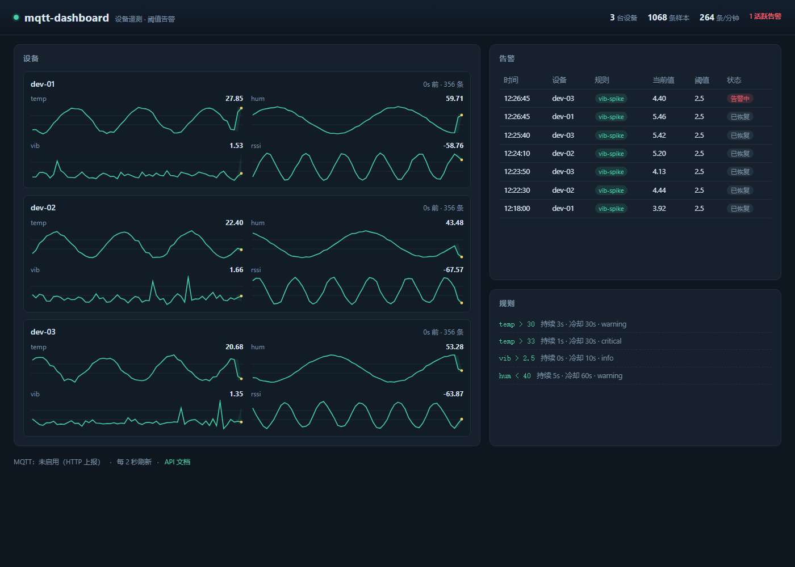

# mqtt-dashboard · 设备遥测看板

[](https://github.com/kesheC/mqtt-dashboard/actions/workflows/ci.yml)
[](https://github.com/kesheC/mqtt-dashboard/tree/main/tests)
[](https://github.com/kesheC/mqtt-dashboard)

CI：`.github/workflows/ci.yml`（Python 3.11–3.12 × Ubuntu/Windows，48 个单测 + 无 broker 端到端冒烟）。

一个完整的 IoT 数据链路：**MQTT / HTTP 入站 → 校验 → SQLite 落库 → 阈值规则引擎 → 看板**。前端无构建（原生 JS + canvas），后端 FastAPI，一条 `docker compose up` 就能跑，没有 broker 也能用 HTTP 上报演示。



*截图是真实运行的看板：3 台设备各自 4 个指标，10 秒聚合的 min/avg/max 带，右侧是规则触发的告警（`vib` 尖峰触发、回落自动恢复）。*

## 架构

```
 设备 / 模拟器
   │  MQTT: devices/<id>/telemetry        HTTP: POST /api/ingest?device=<id>
   ▼                                        ▼
 ┌────────────────────── mqttdash ─────────────────────────────────┐
 │ MqttIngestor (paho, 断线 3s 重连)        api.Pipeline.ingest_raw  │
 │        └──────────────┬──────────────────────────┘              │
 │                parse_payload()  校验：json/数值/时间戳/指标数上限   │
 │                       ▼                                          │
 │                 Store.insert_many()  SQLite WAL + 批量           │
 │                       ▼                                          │
 │            RuleEngine.evaluate()  持续时长 + 冷却 + 恢复           │
 │                       ▼                                          │
 │        alerts 表（started_ts / resolved_ts）                      │
 │                       ▼                                          │
 │  GET /api/{stats,devices,series,alerts,rules,events}  → 静态看板   │
 └─────────────────────────────────────────────────────────────────┘
```

## 快速开始

```bash
pip install -r requirements.txt

# 1. 起服务（不配 MQTT_HOST 时只用 HTTP 上报）
python -m mqttdash                     # http://127.0.0.1:8000

# 2. 造数据（另开一个终端，3 台设备 × 4 指标 × 每秒 2 轮）
python -m mqttdash.sim --devices 3 --rate 2 --duration 60

# 3. 打开看板：http://127.0.0.1:8000/    API 文档：/api/docs
```

有 broker 时（或者直接用 compose）：

```bash
# 本地 mosquitto：启动模拟器走 MQTT 发布
MQTT_HOST=127.0.0.1 python -m mqttdash
python -m mqttdash.sim --mqtt-host 127.0.0.1 --duration 60

# 或者一把梭：mqtt broker + 应用 + 模拟器
docker compose up --build
```

## API

| 方法 | 路径 | 说明 |
| --- | --- | --- |
| POST | `/api/ingest?device=<id>` | 上报。body 支持 `{"ts":ms,"metrics":{...}}`、扁平 `{"temp":25}`、裸数值（需带 ts） |
| GET | `/api/stats` | 总样本数、设备数、每分钟吞吐、活跃告警数、MQTT 状态 |
| GET | `/api/devices` | 设备列表：指标、样本数、最后上报距今 |
| GET | `/api/series?device=&metric=&window=900&bucket=30` | 时间桶聚合（`bucket=0` 返回原始点） |
| GET | `/api/alerts?limit=50&only_active=false` | 告警历史（含恢复时间） |
| GET | `/api/rules` | 当前生效的规则 |
| GET | `/api/events` | 最近触发/恢复的事件（内存环形缓冲，供调试） |
| GET | `/healthz` | 存活探测：MQTT 状态 + 入站统计 |

## 几个设计取舍

**1. 为什么入站要自己做校验，而不是直接写库？**
MQTT 上谁都能往 topic 里发东西。`parse_payload` 拒绝非 JSON、非数值、`NaN`/`Infinity`、布尔值、缺设备名、超过 64 个指标、非 UTF-8 —— 脏数据进库之后很难清理，而且会让 SQL 聚合出现 `NaN`。校验失败计入 `stats.rejected` 并返回 400，**不静默吞掉**。

**2. 为什么用 SQL 做降采样，不在应用里算？**
看板一次要 3 设备 × 4 指标 × 600 秒。把每秒的点全查出来再在 JS 里平均，等于把几十万行搬过网络。`(ts / bucket_ms) * bucket_ms` 让 SQLite 直接按桶聚合（`AVG/MIN/MAX/COUNT`），只传几十个点。**坑**：`GROUP BY ts` 会优先绑定表列而不是别名，写成那样会让聚合静默失效（每条原始数据自己一组），这个 bug 是本仓库测试抓出来的，所以别名改成了 `bucket_ts` 并写了注释。

**3. 为什么桶要按绝对时间对齐，而不是按"窗口起点"？**
对齐到 epoch 秒的整数倍后，每次刷新页面桶边界都一样，柱子不会左右抖动；按窗口起点对齐则会随 `now` 漂移，同一个现象在两次刷新里被切成不同形状。

**4. 规则引擎为什么要"持续时长 + 冷却 + 恢复"三件套？**
- 只要 `duration_s`：单点毛刺（传感器抖一下）立刻报警，运维会关掉告警。
- 只有持续时长：数值在阈值附近抖动时会反复 fire/resolve，形成告警风暴，所以恢复后 `cooldown_s` 内不再重复报。
- 只有 fire 没有 resolve：库里全是永远关不掉的告警，看板失去意义。所以恢复时必须回调 `resolve` —— 这个漏调也是测试抓出来的。

**5. 为什么 SQLite 用 WAL + 单连接加锁？**
写入方是 MQTT 线程和 HTTP 线程，读方是看板轮询。WAL 让读不阻塞写；单连接 + `threading.Lock` 比连接池更简单，而且 SQLite 的并发写本来就是串行的，池化只是把冲突挪进池里。代价是写入吞吐上限受限于单写者，量级到不了一万点/秒——那才需要换时序库。

**6. 前端为什么不用 React/Vue？**
看板只有三块内容，需要的是"打开就能刷新"。原生 JS + canvas 折线，零构建、零依赖、首屏就是 HTML；`fetch` 每 2 秒拉一次，失败时在页脚显示连续失败次数而不是白屏。

## 测试

48 个用例，四层：

- **存储层**：桶聚合的正确性（含桶对齐断言）、原始点模式、窗口过滤、设备汇总、告警写入/恢复幂等、统计、清理、批量插入。
- **规则引擎**：阈值触发、持续时长门限、毛刺重置计时、恢复事件、活跃期不重复触发、冷却期抑制、多设备状态隔离、配置校验（重复 id / 非法操作符 / 坏 JSON）。
- **入站管线**：9 种非法 payload 全部被拒且不落库、秒级时间戳自动升级、扁平与裸数值两种写法、NaN 拒绝、指标数上限、告警落库与恢复、事件环形缓冲上限。
- **HTTP 层**：健康检查、上报后查询联通、400/422 错误码、告警与规则的可见性、索引页可访问、未知路由 404。

```bash
python -m unittest discover -s tests -t .
# Ran 48 tests ... OK
```

## 已知边界

- 单机 SQLite：多副本会各写各的库，没有共享存储；横向扩展需要换成 PostgreSQL/TimescaleDB。
- 规则只能配阈值，没有窗口函数（如"5 分钟内 3 次超限"）、没有通知渠道（邮件/Webhook）。
- 历史数据默认一直留着，`RETENTION_S` 需要在外部定时调用 `Store.prune`（未内置调度器）。
- 看板轮询而非 WebSocket 推送：实现简单，代价是 2 秒延迟与固定 QPS。
- 认证缺失：`/api/ingest` 与看板都在内网假设下，公网部署必须加网关鉴权。
